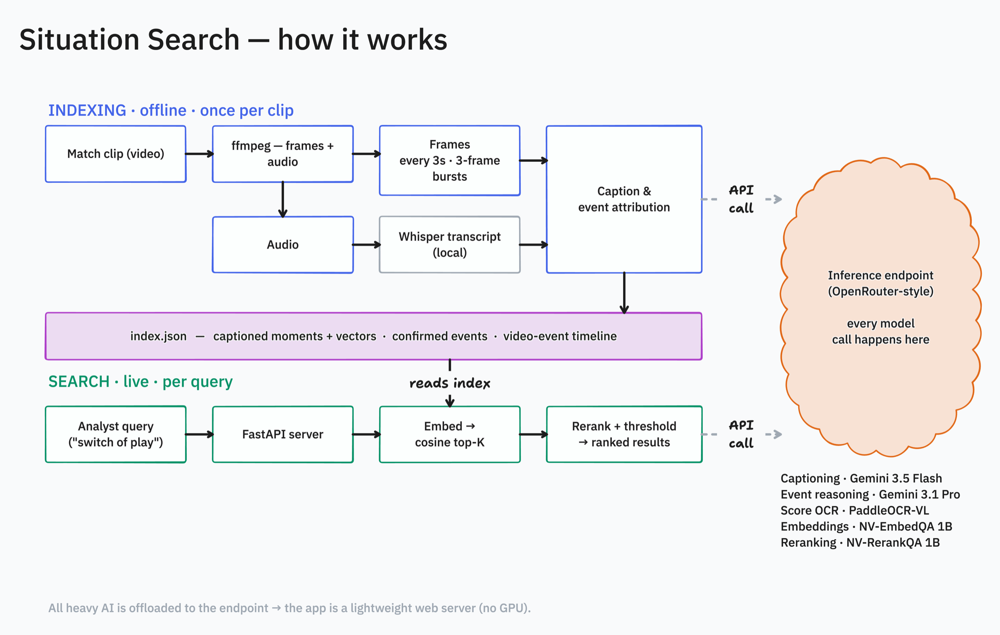

# Situation Search

**Live demo:** https://situsearch.bootloop.cc

A football analyst spends hours scrubbing match video to find one moment.
Situation Search removes the scrubbing. The analyst types what they want to see —
"switch of play", "goalkeeper save", "build-up from the back" — and the app goes
to that moment in the clip. If no moment matches, the app says so. It does not
guess.

The demo runs on two public football highlight reels:
[Manchester United v Manchester City](https://www.youtube.com/watch?v=mHcRPO21qlE)
(seed) and [Arsenal v Manchester United](https://www.youtube.com/watch?v=8I4Vov6p1jI)
(a second, unseen clip for validation).

## What it does

- **Situation search.** Type a query in plain English. The app returns ranked
  moments. It goes to each one in the video.
- **Honest results.** A cross-encoder reranker gives each candidate a score. If no
  candidate clears the clip's calibrated limit, the app returns "no match". For
  example, a search for "recipe for pasta" returns nothing.
- **Set pieces as episodes.** A corner or free kick is one result: the set-up, the
  delivery, and the outcome (goal, save, shot, or cleared). "corner that led to a
  goal" filters on the outcome.
- **Receptions with body shape.** "receiving on the half turn" or "Bruno Fernandes
  receiving the ball" search ball receptions read from the video: receiver, body
  shape (half-turn, open, back to goal), first touch, and pressure. A named-player
  query returns "no match" when that player was never identified.
- **Tactical vocabulary.** The app expands analyst phrases into the descriptive
  language of the captions. Thus "high press" and "switch of play" match on
  meaning.
- **Player highlights.** Get one player's key moments from a clip. The app ranks
  them by event importance.
- **Event timeline.** A video-native event track (goals, shots, saves). It works
  also on footage with no scoreboard and no commentary.
- **Any number of matches.** Every built clip under `data/clips/` appears in the
  header dropdown. Each match has its own index, timeline, players, and cutoff.

## How it works



There are two phases. Indexing runs one time for each clip, offline. Search runs
live, for each query. All heavy AI runs on an OpenRouter-style inference endpoint.
Thus the app stays a small web server.

### Indexing (offline, one time for each clip) — `pipeline/build.py`

0. **Squad sheet (optional).** Put `data/clips/<clip>/lineup.json` next to the
   clip: each team's name, kit, and shirt number to player name. Without it,
   players are identified by team and shirt number only.
1. **Sample.** `ffmpeg` extracts one frame each 3 seconds and one mono audio
   track.
2. **Transcribe.** Local Whisper (large-v3-turbo, MLX) transcribes the commentary,
   if there is commentary. This step is optional.
3. **Caption.** For each moment, a VLM reads a 3-frame burst. It writes a
   structured caption: event, phase, zone, pressure, players, and one factual
   sentence. The caption uses only the frames, the on-screen text, and the squad
   sheet. It never reads the commentary. An OCR model reads the scorebug. The app
   embeds the caption text for search.
4. **Attribute events.** Goals come from the scorebug. The on-screen score
   increases one time for each goal. Thus a replay does not cause a double count.
   The commentary names the scorer. This is the only use of commentary, and the
   last resort: no other signal names a scorer.
5. **Video-native events.** For footage with no scoreboard and no commentary, the
   app divides the clip into 8-second chunks that start every 4 seconds, so an event
   on a chunk boundary is whole in one of them. A video model watches each chunk for
   on-ball events. It identifies each player by jersey number or shirt colour. It does not
   guess a name.
6. **Receptions.** 6-second windows, every 3 seconds, slowed to half speed so the
   model sees about 2 frames per second of real play. The model lists each ball
   reception in live play with team, legible shirt number, body shape, first
   touch, pressure, and zone. Replays and close-ups are skipped.
7. **Calibrate.** Generic football queries ("goal", "goalkeeper save") and
   off-topic queries ("recipe for pasta") are scored against the clip. The
   "no match" cutoff goes a quarter of the way from the best off-topic score to
   the worst football score, and is saved in `data/clips/<clip>/search.json`.

Each stage writes into `data/clips/<clip>/index.json`, where `<clip>` is the video's
file name without the extension. The frames and a copy of the video go in the same
directory.

### Search (live, for each query) — `app/server.py`

0. **Route** by intent. A query that names a set piece searches set-piece
   episodes. A query about receiving or body shape searches receptions, filtered
   on player and body shape. Everything else follows the steps below.
1. **Expand** tactical phrases into a plain-language form.
2. **Retrieve** the top-K moments by cosine similarity to the query embedding.
3. **Rerank** these candidates with a cross-encoder for a calibrated score.
4. **Apply a threshold.** Below the clip's limit, return "no match". Above the
   limit, return ranked moments. Remove near-duplicates in time.

If the endpoint is not available, search changes to keyword matching on the
captions (never the commentary), with common words ignored.

## Engineering decisions

- **Commentary is not a search signal.** Commentators say "corner" about the top
  corner of the goal and "not a corner" about a goal kick. Search and captions
  read only what the video shows.
- **Set pieces are episodes, not frames.** Frames are 3 seconds apart, so one
  corner was four or five separate results with no outcome. Grouping the run of
  set-piece frames and attaching what followed answers "corner that led to a goal".
- **Captions describe the frame, not the commentary.** Early captions gave the
  wrong label. The cause was the commentator, who describes the past. The fix has
  two parts. First, the caption describes only the visible action. Second, it uses
  the motion across a 3-frame burst to find which team has the ball. This
  corrected the label and the time.
- **Retrieve-then-rerank gives honest relevance.** A bi-encoder always returns a
  best result, also for an unrelated query. A cross-encoder reranker and a
  calibrated threshold let the app return "no match". An analyst needs this.
- **A verification test found a confabulation.** The endpoint removes video that
  you send through `video_url`. The model then makes a false scoreline and false
  player names. A perception question showed the problem: the video call gave the
  wrong shirt colours and the wrong score, but a single image gave the correct
  values. The fix was to send each chunk as a `file` content part, which the
  endpoint does pass through (checked with a synthetic clip whose on-screen text
  appears mid-clip; the model reads it). Note: a layer can
  look correct on a selected demo and still be wrong. Always check the output
  against known ground truth.

## Run it

```bash
# Build the index for ANY clip. Nothing is fixed to one match.
CLIP_VIDEO=data/clip2.mp4 python pipeline/build.py   # -> data/clips/clip2/

# The server serves every data/clips/<clip>/index.json it finds. Start it:
./run_server.sh          # open http://127.0.0.1:8008
```

`pipeline/config.py` is the single source of truth for paths and settings. The
endpoint URL and key come from the environment (a git-ignored `.env`):

```
OPENROUTER_URL=https://<endpoint>/v1
OPENROUTER_API_KEY=<key>
```

For the Docker build (no GPU) and public hosting, see `DEPLOY.md`.

## Models

Model routes come from the environment (see `.env.example`), so you can point each
role at any OpenRouter-compatible model. The demo uses:

| Role | Model | Where |
|------|-------|-------|
| Captioning | Gemini 3.5 Flash | endpoint |
| Video events (watches 8s chunks) | Gemini 4 Argon | endpoint |
| Receptions (watches 6s windows) | Gemini 4 Argon | endpoint |
| Event reasoning | Gemini 3.1 Pro | endpoint |
| Score OCR (reads the scorebug) | PaddleOCR-VL | endpoint |
| Query + moment embeddings | NV-EmbedQA 1B | endpoint |
| Reranker | NV-RerankQA 1B | endpoint |
| Commentary ASR | Whisper large-v3-turbo | local (MLX) |

## Validation

An end-to-end test used a second, unseen clip (Arsenal v Manchester United, with
United in a black and yellow away kit). The result: 204 moments and 5
scorebug-confirmed goals with correct names (Timber, Mbeumo, Dorgu, Merino,
Cunha). Search worked with no code changes for the clip; the no-match cutoff is
calibrated for each clip automatically. See `EVAL.md`.

The reception test on that clip found 61 receptions in live play. Only 9 had a
legible shirt number, because players on the wide broadcast camera at 720p are
about 20 pixels tall.

## Limitations

- The demo footage is a copyrighted highlight reel. This is acceptable for a demo.
  A public build needs open or licensed footage (for example SoccerNet).
- Broadcast highlights are close-ups. They are strong for events, but weak for
  full-pitch tactical geometry.
- Player statistics inherit the attribution errors on replay and celebration
  frames.
- With a squad sheet in the prompt, the caption model sometimes names a player
  whose number is not legible. Spot checks found 2 of 4 "Kobbie Mainoo" moments
  wrong.
- Most receivers in wide shots are unidentified. Higher-resolution or full-match
  footage would help more than prompt changes.

## Stack

FastAPI and vanilla JS. `ffmpeg` for sampling. NumPy for the cosine search. Local
Whisper (MLX) for ASR. Docker for deploy. All model inference runs on an
OpenRouter-style endpoint.
