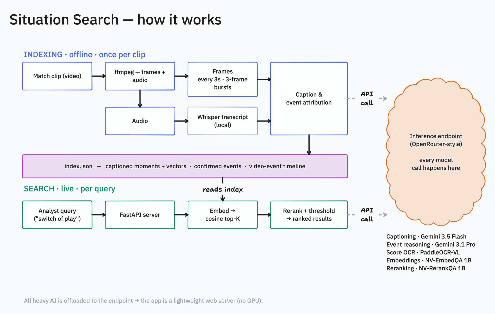

# Situation Search

A football analyst spends hours scrubbing match video to find one moment.
Situation Search removes the scrubbing. The analyst types what they want to see —
"switch of play", "goalkeeper save", "build-up from the back" — and the app goes
to that moment in the clip. If no moment matches, the app says so. It does not
guess.

The demo runs on two public football highlight reels:
[Manchester United v Manchester City](https://www.youtube.com/watch?v=mHcRPO21qlE)
(seed) and [Arsenal v Manchester United](https://www.youtube.com/watch?v=8I4Vov6p1jI)
(a second, unseen clip for validation).

## What it does

- **Situation search.** Type a query in plain English. The app returns ranked
  moments. It goes to each one in the video.
- **Honest results.** A cross-encoder reranker gives each candidate a score. If no
  candidate clears a calibrated limit, the app returns "no match". For example, a
  search for "recipe for pasta" returns nothing.
- **Tactical vocabulary.** The app expands analyst phrases into the descriptive
  language of the captions. Thus "high press" and "switch of play" match on
  meaning.
- **Player highlights.** Get one player's key moments from a clip. The app ranks
  them by event importance.
- **Event timeline.** A video-native event track (goals, shots, saves). It works
  also on footage with no scoreboard and no commentary.

## How it works



There are two phases. Indexing runs one time for each clip, offline. Search runs
live, for each query. All heavy AI runs on an OpenRouter-style inference endpoint.
Thus the app stays a small web server.

### Indexing (offline, one time for each clip) — `pipeline/build.py`

1. **Sample.** `ffmpeg` extracts one frame each 3 seconds and one mono audio
   track.
2. **Transcribe.** Local Whisper (large-v3-turbo, MLX) transcribes the commentary,
   if there is commentary. This step is optional.
3. **Caption.** For each moment, a VLM reads a 3-frame burst. It writes a
   structured caption: event, phase, zone, pressure, players, and one factual
   sentence. The caption is visual-first: the frames are the primary source of
   truth. The commentary is late, because it describes the past. Thus the
   commentary only gives names for players that are on screen. An OCR model reads
   the scorebug. The app embeds the caption text for search.
4. **Attribute events.** Goals come from the scorebug. The on-screen score
   increases one time for each goal. Thus a replay does not cause a double count.
   The commentary gives the name of the scorer. Cards, shots, saves, and fouls
   come from one de-duplicated pass over the transcript.
5. **Video-native events.** For footage with no scoreboard and no commentary, the
   app divides the clip into chunks. It reads each chunk's frame burst for on-ball
   events. It identifies each player by jersey number or shirt colour. It does not
   guess a name.

Each stage writes into `data/index.json`.

### Search (live, for each query) — `app/server.py`

1. **Expand** tactical phrases into a plain-language form.
2. **Retrieve** the top-K moments by cosine similarity to the query embedding.
3. **Rerank** these candidates with a cross-encoder for a calibrated score.
4. **Apply a threshold.** Below the limit, return "no match". Above the limit,
   return ranked moments. Remove near-duplicates in time.

If the endpoint is not available, search changes to keyword matching. Thus the app
continues to run.

## Engineering decisions

- **Captions describe the frame, not the commentary.** Early captions gave the
  wrong label. The cause was the commentator, who describes the past. The fix has
  two parts. First, the caption describes only the visible action. Second, it uses
  the motion across a 3-frame burst to find which team has the ball. This
  corrected the label and the time.
- **Retrieve-then-rerank gives honest relevance.** A bi-encoder always returns a
  best result, also for an unrelated query. A cross-encoder reranker and a
  calibrated threshold let the app return "no match". An analyst needs this.
- **A verification test found a confabulation.** The endpoint removes video that
  you send through `video_url`. The model then makes a false scoreline and false
  player names. A perception question showed the problem: the video call gave the
  wrong shirt colours and the wrong score, but a single image gave the correct
  values. The fix was to send real sampled frames as images. Note: a layer can
  look correct on a selected demo and still be wrong. Always check the output
  against known ground truth.

## Run it

```bash
# Build the index for ANY clip. Nothing is fixed to one match.
CLIP_VIDEO=data/clip2.mp4 python pipeline/build.py

# Start the app
./run_server.sh          # open http://127.0.0.1:8008
```

`pipeline/config.py` is the single source of truth for paths and settings. The
endpoint URL and key come from the environment (a git-ignored `.env`):

```
OPENROUTER_URL=https://<endpoint>/v1
OPENROUTER_API_KEY=<key>
```

For the Docker build (no GPU) and public hosting, see `DEPLOY.md`.

## Models

Model routes come from the environment (see `.env.example`), so you can point each
role at any OpenRouter-compatible model. The demo uses:

| Role | Model | Where |
|------|-------|-------|
| Captioning / video events | Gemini 3.5 Flash | endpoint |
| Event reasoning | Gemini 3.1 Pro | endpoint |
| Score OCR (reads the scorebug) | PaddleOCR-VL | endpoint |
| Query + moment embeddings | NV-EmbedQA 1B | endpoint |
| Reranker | NV-RerankQA 1B | endpoint |
| Commentary ASR | Whisper large-v3-turbo | local (MLX) |

## Validation

An end-to-end test used a second, unseen clip (Arsenal v Manchester United, with
United in a black and yellow away kit). The result: 204 moments and 5
scorebug-confirmed goals with correct names (Timber, Mbeumo, Dorgu, Merino,
Cunha). The search and the no-match threshold worked with no per-clip changes. See
`EVAL.md`.

## Limits and next steps

- The seed clip is a copyrighted highlight reel. This is acceptable for a demo. A
  public build needs open or licensed footage (for example SoccerNet).
- Highlights are close-ups. They are good for events, but weak for full tactical
  geometry. The next retrieval mode is a tracking-geometry layer (player positions
  across a window) for spatial queries.
- Player statistics include the attribution errors on replay or celebration
  frames.
- The frontend is vanilla JS. A rebuild in Vite, React, and TypeScript is the next
  step for production.

## Stack

FastAPI and vanilla JS. `ffmpeg` for sampling. NumPy for the cosine search. Local
Whisper (MLX) for ASR. Docker for deploy. All model inference runs on an
OpenRouter-style endpoint.
